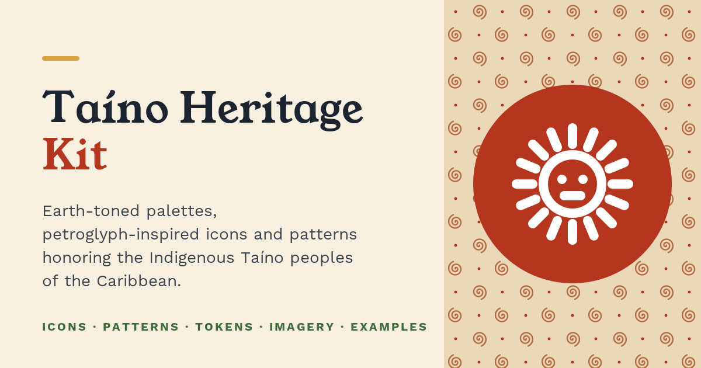
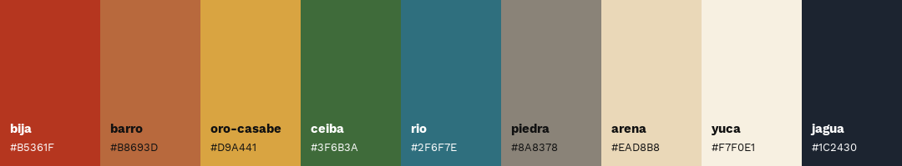
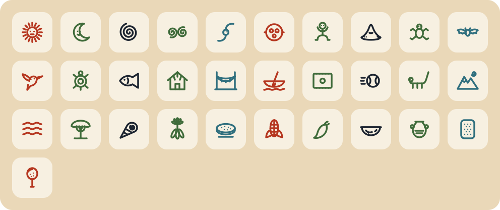
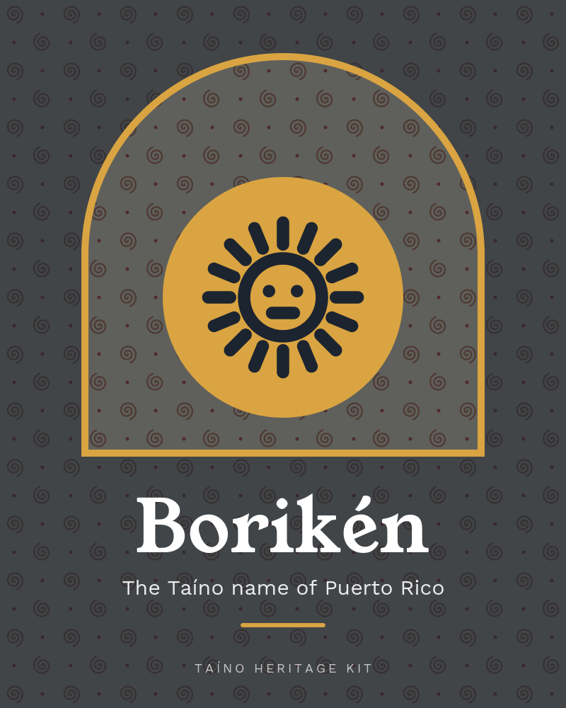
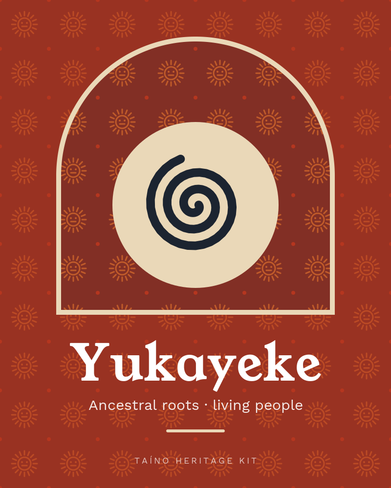
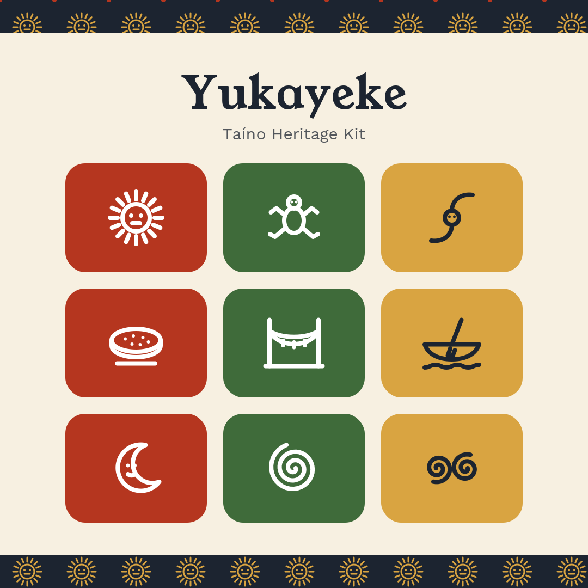

# Taíno Heritage Kit

> Earth-toned palettes, petroglyph-inspired icons and patterns honoring the Indigenous Taíno peoples of the Caribbean.



[](https://creativecommons.org/licenses/by/4.0/)


An open-source asset pack for anyone building **websites, web apps and mobile apps** centered on Taíno. Drop in the tokens, icons, patterns and imagery, or start from one of the example builds.

**Live style guide:** open [`index.html`](index.html) (or enable GitHub Pages: *Settings → Pages → Deploy from branch → `main` / root*).

---

## What's inside

| Folder | Contents |
|---|---|
| [`tokens/`](tokens) | `tokens.css` (CSS variables), `_tokens.scss`, `tokens.json` (W3C design-token format, works with Tokens Studio / Style Dictionary), `colors.json`, `tailwind.preset.js` |
| [`icons/`](icons) | **31 SVG icons** (24×24, 1.75 stroke, `currentColor`), `sprite.svg`, `icons.json` metadata, `index.mjs` (JS strings), `react.mjs` (React component), PNG exports at 128px (dark + white) |
| [`patterns/`](patterns) | **5 seamless SVG patterns** + `patterns.css` utility classes (data-URI, zero requests) + PNG previews |
| [`imagery/`](imagery) | 3 illustrations / photos (original JPG + responsive WebP at 800 & 1600px) |
| [`graphics/`](graphics) | Posters, Open Graph banner (1200×630), social post (1080²), app icon (SVG + PNG 64–1024), 6 stickers / badges |
| [`css/kit.css`](css/kit.css) | Ready components: buttons, chips, cards, inputs, icon tiles, nav, hero, dashboard, phone frames |
| [`examples/`](examples) | 3 complete example builds: [website](examples/website/index.html), [mobile app](examples/mobile-app/index.html), [web app dashboard](examples/web-app/index.html) |
| [`CULTURAL-GUIDE.md`](CULTURAL-GUIDE.md) | How to use this culture's symbols respectfully |

## Preview





<p>
  
</p>

## Quick start

### Plain HTML

```html
<link rel="stylesheet" href="tokens/tokens.css">     <!-- variables + Google Fonts -->
<link rel="stylesheet" href="patterns/patterns.css"> <!-- .pattern-* backgrounds -->
<link rel="stylesheet" href="css/kit.css">           <!-- optional components -->

<body class="kit">
  <button class="btn btn-primary">
    <svg width="18" height="18"><use href="icons/sprite.svg#sol-petroglifo"/></svg>
    Get started
  </button>
  <div class="pattern-espirales" style="height:120px"></div>
</body>
```

### npm / JavaScript

```bash
npm install github:YOUR-USERNAME/taino-heritage-kit
```

```js
import { icon, icons } from 'taino-heritage-kit';
document.querySelector('#logo').innerHTML = icon('sol-petroglifo', { size: 48 });

import 'taino-heritage-kit/tokens.css';
```

### React

```jsx
import { Icon } from 'taino-heritage-kit/react';

<Icon name="sol-petroglifo" size={32} style={{ color: 'var(--kit-primary)' }} title="Sun motif in petroglyph style" />
```

### Tailwind CSS

```js
// tailwind.config.js
module.exports = { presets: [require('taino-heritage-kit/tokens/tailwind.preset.js')] };
// <div class="bg-primary text-on-primary font-display">…</div>
```

### React Native / Flutter / SwiftUI

Use `tokens/tokens.json` or `tokens/colors.json` for colors, and the PNG icons in `icons/png/` (or the SVGs via `react-native-svg` / `flutter_svg`).

## Colors

| | Token | Hex | Meaning |
|---|---|---|---|
|  | `bija` | `#B5361F` | Bija / achiote red — natural pigment used for body paint and dye |
|  | `barro` | `#B8693D` | Barro — fired clay of burén griddles and vessels |
|  | `oro-casabe` | `#D9A441` | Oro casabe — toasted cassava bread |
|  | `ceiba` | `#3F6B3A` | Ceiba green — the sacred tree |
|  | `rio` | `#2F6F7E` | Río — mountain river water |
|  | `piedra` | `#8A8378` | Piedra — river stone of the petroglyphs |
|  | `arena` | `#EAD8B8` | Arena — sand and batey earth |
|  | `yuca` | `#F7F0E1` | Yuca — cassava-flesh cream background |
|  | `jagua` | `#1C2430` | Jagua — deep indigo pigment from the jagua fruit; text color |

**Semantic roles** (use these in components so themes stay swappable):

| Variable | Value |
|---|---|
| `--kit-primary` | `#B5361F` |
| `--kit-secondary` | `#3F6B3A` |
| `--kit-accent` | `#D9A441` |
| `--kit-surface` | `#F7F0E1` |
| `--kit-surface-alt` | `#EAD8B8` |
| `--kit-text` | `#1C2430` |
| `--kit-success` | `#3F6B3A` |
| `--kit-info` | `#2F6F7E` |
| `--kit-on-primary` | `#FFFFFF` |
| `--kit-on-secondary` | `#FFFFFF` |
| `--kit-on-accent` | `#1C2430` |

## Typography

| Role | Font | Notes |
|---|---|---|
| Display | **Young Serif** | Headlines, posters, logos |
| Body | **Work Sans** | UI and long-form text |

Both are free under the SIL Open Font License via [Google Fonts](https://fonts.googleapis.com/css2?family=Young+Serif&family=Work+Sans:wght@400;600;700&display=swap). `tokens.css` imports them automatically.

## Icons (31)

**Sky & Spirit (stylized)** — [`sol-petroglifo`](icons/svg/sol-petroglifo.svg), [`luna`](icons/svg/luna.svg), [`espiral`](icons/svg/espiral.svg), [`doble-espiral`](icons/svg/doble-espiral.svg), [`huracan`](icons/svg/huracan.svg), [`rostro`](icons/svg/rostro.svg), [`figura-ancestral`](icons/svg/figura-ancestral.svg), [`cemi-tres-puntas`](icons/svg/cemi-tres-puntas.svg)

**Creatures** — [`coqui-petroglifo`](icons/svg/coqui-petroglifo.svg), [`murcielago`](icons/svg/murcielago.svg), [`colibri`](icons/svg/colibri.svg), [`tortuga-petroglifo`](icons/svg/tortuga-petroglifo.svg), [`pez`](icons/svg/pez.svg)

**Land & Home** — [`bohio`](icons/svg/bohio.svg), [`hamaca`](icons/svg/hamaca.svg), [`canoa`](icons/svg/canoa.svg), [`batey`](icons/svg/batey.svg), [`pelota-batu`](icons/svg/pelota-batu.svg), [`duho`](icons/svg/duho.svg), [`montana`](icons/svg/montana.svg), [`rio`](icons/svg/rio.svg), [`ceiba-sagrada`](icons/svg/ceiba-sagrada.svg), [`caracol-guamo`](icons/svg/caracol-guamo.svg)

**Food & Craft** — [`yuca`](icons/svg/yuca.svg), [`casabe`](icons/svg/casabe.svg), [`maiz`](icons/svg/maiz.svg), [`aji`](icons/svg/aji.svg), [`higuera-jicara`](icons/svg/higuera-jicara.svg), [`vasija`](icons/svg/vasija.svg), [`guayo`](icons/svg/guayo.svg), [`maraca-taina`](icons/svg/maraca-taina.svg)

All icons are 24×24, `stroke="currentColor"`, so they inherit text color. Metadata (category, description) lives in [`icons/icons.json`](icons/icons.json).

## Patterns

| Preview | Name | Use |
|---|---|---|
|  | `espirales` | `.pattern-espirales` · [`patterns/espirales.svg`](patterns/espirales.svg) |
|  | `soles` | `.pattern-soles` · [`patterns/soles.svg`](patterns/soles.svg) |
|  | `zigzag` | `.pattern-zigzag` · [`patterns/zigzag.svg`](patterns/zigzag.svg) |
|  | `incisiones` | `.pattern-incisiones` · [`patterns/incisiones.svg`](patterns/incisiones.svg) |
|  | `rio` | `.pattern-rio` · [`patterns/rio.svg`](patterns/rio.svg) |

## Imagery

| Preview | File | Description |
|---|---|---|
|  | `hero-batey.jpg` | Ceremonial batey plaza with carved stones, a ceiba tree and a bohío in the mountains |
|  | `petroglyph-stone.jpg` | Petroglyphs of spirals and faces carved in a river stone |
|  | `casabe-still-life.jpg` | Casabe on a burén griddle with yuca, a gourd bowl, a duho and a hamaca |

> Imagery was AI-generated for this kit. It does not depict real, identifiable people. Review images in context before use, and consider commissioning artists from the community for flagship work.

## Accessibility

| Pairing | Colors | Contrast | WCAG |
|---|---|---|---|
| Body text on surface | `#1C2430` on `#F7F0E1` | 13.77:1 | AAA |
| Text on primary | `#FFFFFF` on `#B5361F` | 5.98:1 | AA |
| Text on secondary | `#FFFFFF` on `#3F6B3A` | 6.22:1 | AA |
| Text on accent | `#1C2430` on `#D9A441` | 6.94:1 | AA |

- Decorative icons should get `aria-hidden="true"`; meaningful icons need a `title` / `aria-label`.
- Never rely on color alone to convey meaning; pair it with an icon or text.
- Pattern backgrounds are decorative. Place text over a solid overlay.

## Cultural guide

Please read **[CULTURAL-GUIDE.md](CULTURAL-GUIDE.md)** before shipping. In short:

- Present the Taíno as a living people, not a lost or extinct culture.
- Partner with and credit contemporary Taíno organizations and artists, and pay Indigenous creators where you can.
- Treat these icons as stylized interpretations. Petroglyphs and cemís are sacred, so avoid presenting them as decorative trivia.

## License & attribution

Everything in this repository is licensed under **[Creative Commons Attribution 4.0 (CC BY 4.0)](LICENSE)**. You may use it commercially, remix it and redistribute it as long as you give credit:

```
"Taíno Heritage Kit" (https://github.com/YOUR-USERNAME/taino-heritage-kit) — CC BY 4.0
```

Fonts are not bundled; they are loaded from Google Fonts under the SIL OFL.

## Contributing

New icons, translations, patterns and corrections are welcome, especially from members of the community. See [CONTRIBUTING.md](CONTRIBUTING.md).

## Publish this repo

```bash
cd taino-heritage-kit
gh repo create taino-heritage-kit --public --source=. --push \
  --description "Earth-toned palettes, petroglyph-inspired icons and patterns honoring the Indigenous Taíno peoples of the Caribbean."
# then: Settings → Pages → Deploy from branch → main / (root)
```
